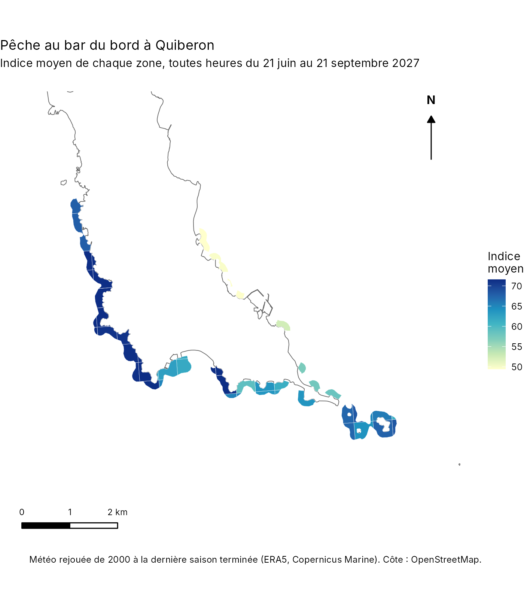

# BarPêche : atlas horaire de la pêche au bar du bord à Quiberon

Où et à quelle heure pêcher le bar depuis les rochers de la presqu'île de Quiberon, du 21 juin au 21 septembre ? L'atlas donne, pour chaque zone de côte rocheuse et chaque heure de la saison, un indice de 0 à 100 et la probabilité que la zone fasse partie des meilleures. Les résultats se consultent dans une application R Shiny.

Projet personnel, 2026. L'atlas se recalcule chaque année pour la saison suivante (2027 actuellement).



## Résultats en bref

- 51 zones couvrent la bande de mer de 120 m (la portée d'un lancer) au pied de la côte rocheuse : 24 exposées, 24 intermédiaires, 3 abritées.
- Sur l'ensemble de la saison, les zones de la côte ouest, tournées vers l'ouest et le sud-ouest, ont le meilleur indice moyen (autour de 70). La côte est, tournée vers la baie et abritée de la houle d'ouest, est la moins favorable (autour de 50).
- L'indice moyen cache l'essentiel : d'une heure à l'autre, la marée, la lumière et le vent font changer le classement. C'est pour ça que l'atlas est horaire.

## L'application

Elle affiche la carte des zones heure par heure, avec un calendrier de la saison, les conditions de l'heure (marée, lumière, vent habituel, houle, température de l'eau) et, au clic sur une zone, le détail de ses quatre facteurs et ses meilleurs créneaux.

```r
install.packages(c("shiny", "leaflet", "sf", "jsonlite"))
shiny::runApp()
```

Les résultats sont déjà dans `data/processed/v2/` : pas besoin de relancer la chaîne pour consulter l'atlas. Une version en page HTML autonome est aussi produite (`data/output/atlas/atlas_2027.html`).

## Données

| Source | Utilisation |
|---|---|
| [geo.api.gouv.fr](https://geo.api.gouv.fr) | Contour de la commune de Quiberon, élargi de 500 m |
| [OpenStreetMap](https://www.openstreetmap.org) (API Overpass) | Trait de côte, plages et ports (exclus des zones) |
| [ERA5](https://cds.climate.copernicus.eu) (Copernicus Climate) | Vent horaire, 2000 à la dernière saison terminée |
| [Copernicus Marine](https://marine.copernicus.eu) : IBI vagues | Houle horaire au 1/36° |
| Copernicus Marine : OSTIA | Température de l'eau |
| Copernicus Marine : IBI physique | Niveau de la mer et courants sur 12 mois, pour l'analyse harmonique de la marée |

Les fichiers bruts (environ 100 Mo) ne sont pas dans le dépôt : la chaîne les télécharge.

## Méthode

1. **Zones.** La bande de mer de 120 m au pied de la côte rocheuse est découpée en zones. Pour chacune, un rayon part tous les 5° et mesure la distance d'eau libre jusqu'à la première côte : c'est ce qui dit si la zone est exposée à un vent ou à une houle venant de cette direction.
2. **Marée et courants.** Une analyse harmonique (utide) décompose 12 mois de niveau de la mer et de courants du modèle IBI en ondes de marée, puis les recompose aux dates de la saison cible. La marée est astronomique, donc prévisible à l'avance.
3. **Météo rejouée.** Le vent, la houle et la température de l'eau de la saison cible ne sont pas connus. Pour chaque heure, l'atlas rejoue donc la météo observée à la même heure, à 3 jours près, pour toutes les années depuis 2000, soit environ 190 tirages par heure.
4. **Score.** Quatre facteurs entre 0 et 1 : agitation (ressac ou clapot porté vers la zone) 30 %, courant de marée 25 %, lumière (aube et crépuscule au plus haut, plein jour faible) 30 %, température de l'eau 15 %. Ils sont combinés par une moyenne géométrique pondérée : un facteur franchement mauvais tire le score vers le bas, les autres ne peuvent pas le compenser entièrement.
5. **Résultats.** L'indice est le score moyen sur les tirages. Les chances sont la part des tirages où la zone se classe dans le meilleur cinquième.

## Limites

- Les poids des facteurs viennent de la lecture d'articles de pêche et de littérature, pas d'un calage sur des prises réelles : je n'ai pas de carnet de pêche pour les vérifier.
- Houle et courants sortent d'un modèle à mailles de 2 à 3 km : le détail d'une crique ou d'une pointe n'est pas résolu.
- La surcote météo n'est pas incluse dans la marée. Les hauteurs sont données par rapport au niveau moyen, pas au zéro des cartes.
- C'est un atlas climatologique : le jour même, une prévision à trois jours vaut mieux que cette carte.
- Règles de pêche de loisir du bar en 2026 au sud du 48e parallèle : deux poissons par pêcheur et par jour, 42 cm minimum. À vérifier chaque année.

## Relancer la chaîne de calcul

La chaîne est en Python (environnement Anaconda). Il faut un compte Copernicus Marine et un compte Copernicus Climate (clé dans `%USERPROFILE%\.cdsapirc`).

```
pip install utide copernicusmarine cdsapi geopandas xarray netcdf4 scipy
copernicusmarine login
python chaine/v2_run.py
```

Premier lancement : 30 à 90 minutes, surtout la file d'attente d'ERA5. Ensuite, la chaîne ne télécharge que ce qui manque et ne recalcule que si quelque chose a changé. Sous Windows, `planifier_mise_a_jour.bat` crée une tâche qui lance la mise à jour le 1er de chaque mois. Options : `--force` (tout recalculer), `--gpkg` (GeoPackage pour le contrôleur temporel de QGIS), `--sans-telechargement`. Pour forcer une autre saison : variable d'environnement `BARPECHE_ANNEE`.

- `chaine/v2_config.py` : tous les réglages (fenêtre, poids, seuils, sources)
- `chaine/v2_00_socle.py` : trait de côte et zones de départ
- `chaine/v2_01_download.py` : téléchargements Copernicus
- `chaine/v2_02_zones.py` : zones et exposition
- `chaine/v2_03_tides.py` : marée et courants de la saison
- `chaine/v2_04_score.py` : indice et chances par zone et par heure
- `chaine/v2_05_atlas.py`, `chaine/v2_atlas_template.html` : page HTML autonome, CSV, GeoPackage
- `chaine/v2_run.py` : toute la chaîne dans l'ordre ; `chaine/v2_lib.py` : fonctions communes
- `app.R`, `R/donnees.R` : application Shiny
- `R/figure_readme.R` : carte de ce README

Armand Lecoq, novembre 2026.
